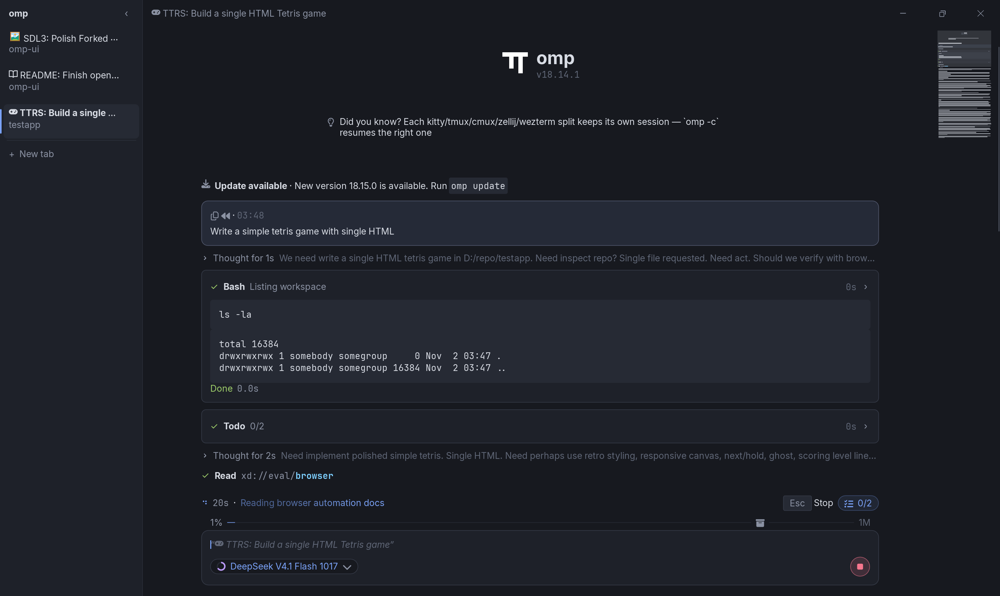
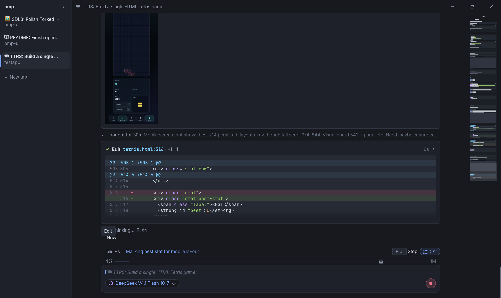

# omp-ui
~~terncraft~~

A native [TSP](https://docs.stencil.so/tern/protocol/) renderer for the `omp` coding agent, for people who want a GUI without running Tern.

Built in C++20 with SDL3 and Yoga. Cross-platform support is in place, though only Windows has been properly tested so far.




## Usage

Make sure `omp` is installed and in your `PATH`, then launch `omp-ui` and pick a workspace folder.

You can also pass a folder or custom command on startup:

```sh
omp-ui [folder]
omp-ui [folder] -- omp [args...]
```

The command can run omp on another machine over ssh: `omp-ui -- ssh -t host omp` (omp and bun must be on the PATH of ssh's non-interactive shell there). Dropped files paste local paths, which a remote omp can't open.

From there, use `omp` as usual.

### Shortcuts

| Shortcut | Action |
| --- | --- |
| `Ctrl+Shift+T` | New tab (right-click the `+` button for recent workspaces) |
| `Ctrl+Shift+W` | Close tab |
| `Ctrl+Tab` / `Ctrl+Shift+Tab` | Next / previous tab |
| `Ctrl+Shift+1`–`9` | Jump to tab |
| `Ctrl+Shift+B` | Toggle sidebar |
| `Ctrl+Shift+F` | Search the transcript |
| `Ctrl+Shift+Alt+T` | Split tab into a new window |
| `Ctrl+Shift+Alt+M` | Merge windows |
| `F12` | Toggle TSP inspector |

Transcript search (`Cmd+F` on macOS) has case-sensitive (`Aa`) and regular-expression (`.*`) toggles.
While the search field is focused, `Enter` / `F3` moves to the next match, `Shift+Enter` / `Shift+F3` to the previous,
`Alt+C` and `Alt+R` toggle the options, and `Esc` closes it. Clicking outside the field returns
every key to omp (only `F3` still steps through matches) while keeping the highlights. The overview scrollbar
shows user prompts and search matches; clicking its track jumps to that position.

## Configuration & Themes

On first launch, `omp-ui` creates a config directory at `%APPDATA%\omp\omp-ui` (`~/.local/share/omp/omp-ui` on Linux, `~/Library/Application Support/omp/omp-ui` on macOS) with `config.json` and starter themes in `themes/dark.json` and `themes/light.json`.

You can edit the theme JSON files to customize colors, window opacity, blur/acrylic backdrops, and background images, or set `OMP_UI_THEME=<name>` to switch themes via environment variable.

For OLED screens, an idle window dims everything except the transcript after 5 minutes; set `"dimAfter"` (seconds, `0` to disable) in `config.json` to change that.

Short UI transitions are on by default; set `"animations": false` in `config.json` to switch them off.

When omp finishes a turn in a tab you aren't looking at, omp-ui shows a Windows notification; set `"notify"` in `config.json` to `"sound"` (sound only) or `"silent"` to change that.

## Building

Requires CMake (3.24+), Ninja, Git, and a C++20 compiler (Visual Studio on Windows). SDL3, SDL_ttf, Yoga, and lunasvg are fetched automatically by CMake.

On Windows:

```bat
build.cmd
```

Or with CMake directly:

```sh
cmake -B build -G Ninja -DCMAKE_BUILD_TYPE=Release
cmake --build build
```

## Contributing

Issues and pull requests are welcome.
